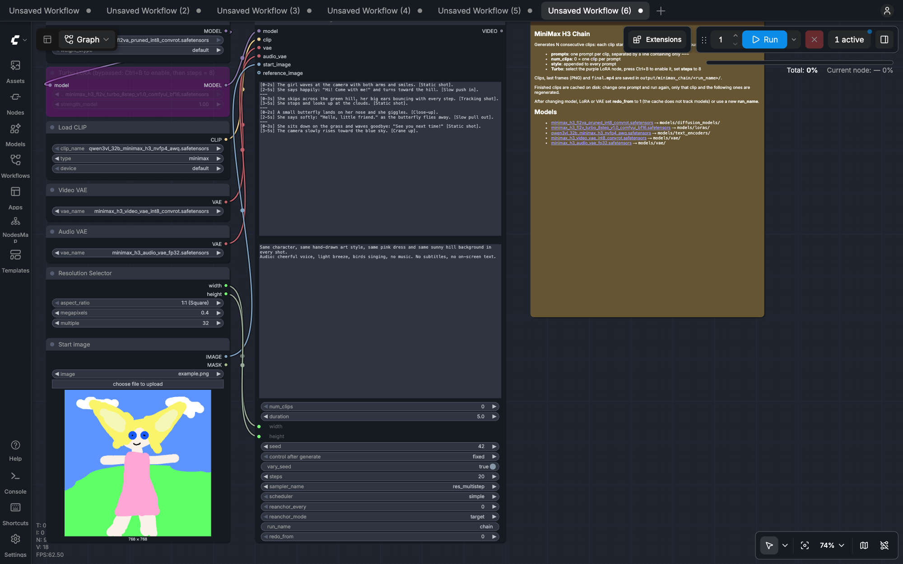

# ComfyUI MiniMax H3 Chain

A ComfyUI node that chains [MiniMax H3](https://www.minimax.io/blog/minimax-h3) clips into one long video:

```
start image (optional) → clip 1 → last frame → clip 2 → last frame → … → clip N → merged video
```

You write one prompt per clip. The node generates the clips one after another, each starting from the last frame of the previous clip. Without a start image, clip 1 is generated from text only (text-to-video). It saves every clip and every last frame, and returns the merged video with audio.



## Features

- **Any number of clips** in a single node. Only the current clip is kept in memory.
- **One prompt per clip**, separated by `---`, plus a shared **style** text appended to every prompt.
- **Disk cache**: finished clips are reused.
  - Change one prompt or seed and run again: only that clip and the ones after it are regenerated.
  - An interrupted run resumes where it stopped.
- **Seamless merge**: the duplicated frame at each join (and 1/24 s of its audio) is dropped.
- **Anti-drift**: every K clips the chain goes back to a reference image, either ending on it or starting from it.
- Uses ComfyUI's own MiniMax H3 nodes and samplers. It has no extra Python dependencies.

## Requirements

- A ComfyUI version with native MiniMax H3 support (the `MiniMaxH3ImageToVideo` node). Tested with ComfyUI 0.41.0.
- The MiniMax H3 models from [Comfy-Org/MiniMax-H3](https://huggingface.co/Comfy-Org/MiniMax-H3):

| File                                                                                                                                                                                                   | Folder                     |
| ------------------------------------------------------------------------------------------------------------------------------------------------------------------------------------------------------ | -------------------------- |
| [minimax_h3_fl2va_pruned_int8_convrot.safetensors](https://huggingface.co/Comfy-Org/MiniMax-H3/resolve/main/diffusion_models/minimax_h3_fl2va_pruned_int8_convrot.safetensors)                         | `models/diffusion_models/` |
| [qwen3vl_32b_minimax_h3_nvfp4_awq.safetensors](https://huggingface.co/Comfy-Org/MiniMax-H3/resolve/main/text_encoders/qwen3vl_32b_minimax_h3_nvfp4_awq.safetensors)                                    | `models/text_encoders/`    |
| [minimax_h3_video_vae_int8_convrot.safetensors](https://huggingface.co/Comfy-Org/MiniMax-H3/resolve/main/vae/minimax_h3_video_vae_int8_convrot.safetensors)                                            | `models/vae/`              |
| [minimax_h3_audio_vae_fp32.safetensors](https://huggingface.co/Comfy-Org/MiniMax-H3/resolve/main/vae/minimax_h3_audio_vae_fp32.safetensors)                                                            | `models/vae/`              |
| [minimax_h3_fl2v_turbo_8step_v1.0_comfyui_bf16.safetensors](https://huggingface.co/lightx2v/Minimax-h3-Turbo/resolve/main/minimax_h3_fl2v_turbo_8step_v1.0_comfyui_bf16.safetensors) (optional, turbo) | `models/loras/`            |

## Installation

```bash
cd ComfyUI/custom_nodes
git clone https://github.com/flaviodelgrosso/comfyui-minimax-chain.git
```

Restart ComfyUI. The node appears as **MiniMax H3 Chain Video** in the `video/minimax` category.

## Quick start

1. Open `example_workflows/minimax_h3_chain.json`: drag it onto the canvas, or find it under **Templates** in the custom node examples.
2. Pick a start image in **Start image** (or remove it for text-to-video) and the size in **Resolution Selector**.
3. Write your prompts in **prompts**, one per clip, separated by a line containing only `---`.
4. Press **Run**.

Output files go to `ComfyUI/output/minimax_chain/<run_name>/`:

```
clip_001.mp4   clip_001_last.png
clip_002.mp4   clip_002_last.png
…
final.mp4      manifest.json
```

The node previews `final.mp4`, and its `VIDEO` output can feed other video nodes.

## Apple Silicon variant

`example_workflows/minimax_h3_chain_mac.json`:

```
GGUF model → Parasyte Turbo LoRA (1.5) → H3 AdaLN LoRA fix (strip) → MiniMax H3 Sigma Shift (12 / 3) → chain node (8 steps, er_sde / beta57)
```

The text encoder is a GGUF build, because the default NVFP4-AWQ encoder has no native Apple Silicon kernels. The default size is 0.2 MP, the MacMax starting point; raise it for final renders.

Extra node packs:

- [ComfyUI-GGUF](https://github.com/city96/ComfyUI-GGUF): `UnetLoaderGGUF`, `CLIPLoaderGGUF`
- [ComfyUI-PlagueKind-Nodes](https://github.com/PlagueKind/ComfyUI-PlagueKind-Nodes): `H3AdaLNLoRAFix`
- [RES4LYF](https://github.com/ClownsharkBatwing/RES4LYF): the `beta57` scheduler

Models (about 36 GB):

| File                                                                                                                                                   | Folder                     |
| ------------------------------------------------------------------------------------------------------------------------------------------------------ | -------------------------- |
| [MiniMax-H3-FL2VA-Pruned-Q5_K_M.gguf](https://huggingface.co/Abiray/MiniMax-H3-Pruned-GGUF/resolve/main/MiniMax-H3-FL2VA-Pruned-Q5_K_M.gguf) (14.1 GB) | `models/diffusion_models/` |
| [qwen3vl-32B-MiniMax-H3-Q4_K_M.gguf](https://huggingface.co/realrebelai/MiniMax-H3_GGUFs/resolve/main/qwen3vl-32B-MiniMax-H3-Q4_K_M.gguf) (14.6 GB)    | `models/text_encoders/`    |
| [H3-PK-Parasyte-Turbo.safetensors](https://huggingface.co/Plaguekind/H3-Lora/resolve/main/H3-PK-Parasyte-Turbo.safetensors) (2.1 GB)                   | `models/loras/`            |
| [minimax_h3_video_vae_fp16.safetensors](https://huggingface.co/Comfy-Org/MiniMax-H3/resolve/main/vae/minimax_h3_video_vae_fp16.safetensors) (5.2 GB)   | `models/vae/`              |
| [minimax_h3_audio_vae_fp32.safetensors](https://huggingface.co/Comfy-Org/MiniMax-H3/resolve/main/vae/minimax_h3_audio_vae_fp32.safetensors) (0.6 GB)   | `models/vae/`              |

Do not combine EasyCache or Spectrum with Parasyte: the MacMax authors report visible artifacts.

## Inputs

| Input                                                | Description                                                                                                                                                                      |
| ---------------------------------------------------- | -------------------------------------------------------------------------------------------------------------------------------------------------------------------------------- |
| `model`, `clip`, `vae`, `audio_vae`                  | MiniMax H3 diffusion model (optionally through the turbo LoRA), text encoder (`CLIPLoader` type `minimax`), video VAE and audio VAE                                              |
| `start_image`                                        | Optional first frame of clip 1. Leave empty to generate clip 1 from text only                                                                                                    |
| `prompts`                                            | One prompt per clip, separated by `---` lines                                                                                                                                    |
| `style`                                              | Text appended to every prompt (look, camera, audio)                                                                                                                              |
| `num_clips`                                          | Number of clips; `0` = one clip per prompt. Fewer prompts than clips repeats the last prompt; extra prompts are ignored. A warning is logged in both cases.                      |
| `duration`                                           | Seconds per clip, snapped up to the model's 17k+5 frame grid at 24 fps (5 s = 124 frames)                                                                                        |
| `width`, `height`                                    | Canvas size; the example links them to a Resolution Selector                                                                                                                     |
| `seed`, `vary_seed`                                  | Base seed; with `vary_seed` each clip uses `seed + clip index`                                                                                                                   |
| `steps`, `sampler_name`, `scheduler`                 | Sampling (default `20`, `res_multistep`, `simple`; use 8 steps with the turbo LoRA)                                                                                              |
| `reanchor_every`, `reanchor_mode`, `reference_image` | Anti-drift, see below                                                                                                                                                            |
| `run_name`                                           | Output folder name (letters, digits, `-`, `_`)                                                                                                                                   |
| `redo_from`                                          | Regenerate from this clip onwards even if cached; `0` = off                                                                                                                      |
| `color_match`                                        | `0`–`1`: before each chained clip, match the hue and saturation of its start frame to the reference image (Lab a/b channels; brightness and contrast are not changed). `0` = off |

## Fixing a clip

Edit that clip's block in **prompts**, or change the seed, and run again. Earlier clips come from the cache. The edited clip is regenerated, and so are the clips after it, because they start from its new last frame.

The cache is keyed on prompt, seed, size, duration, sampling settings and the input frame. It does **not** track the model, LoRA or VAE. After changing them, set `redo_from` to `1` for one run (then back to `0`), or use a new `run_name`.

## Anti-drift

Over many clips, faces and details slowly drift. With `reanchor_every = K`:

- **`target`** (default): clips K, 2K, … are generated with the reference image as their last frame. The chain returns smoothly to the reference with no cut.
- **`replace`**: clips K+1, 2K+1, … start from the reference image instead of the previous last frame. This gives a hard cut, so those clips keep their first frame in the merge.

`reference_image` defaults to `start_image`, or to the last frame of clip 1 when there is no start image.

Each clip starts from a generated, VAE-decoded frame, so colors, contrast and skin texture degrade a little at every hop. Two settings counter this:

- `color_match` (try `0.5`–`1.0`) corrects color and skin-tone drift before every chained clip without touching contrast.
- `reanchor_every = 2` with `target` brings the look back to the original photo every second clip.

Final renders also degrade less at higher resolution (0.4 MP or more) and without the turbo LoRA.

## Tips

- Use a sharp start image. End each clip on a calm, front-facing moment, because that frame starts the next clip.
- Describe the character, outfit, background and lighting the same way in every clip; the `style` input does this for you.
- Only the frame carries over, not motion or sound. Keep camera moves consistent between neighbouring prompts, and don't split a sentence of dialogue across two clips.
- Iterate fast with the turbo LoRA (8 steps) and a low resolution, then switch to the final settings. Changing these settings regenerates all clips.
- `final.mp4` is overwritten on every run of the same `run_name`.

## License

[GPL-3.0](LICENSE), the same license as ComfyUI.
